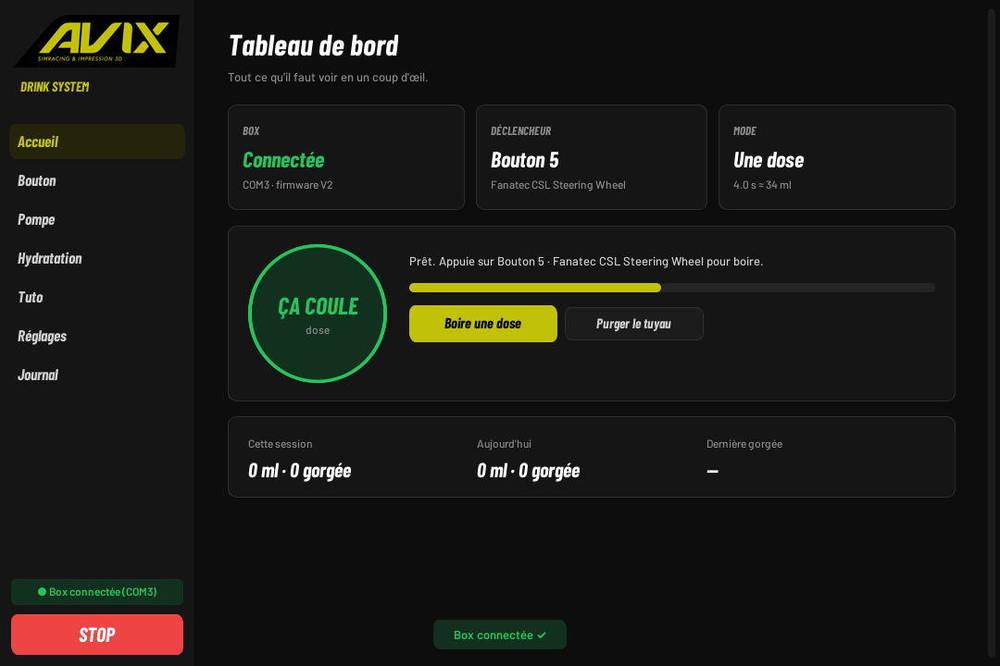

# AVIX Drink System — application Windows

Application Windows pour la **drink box AVIX** : boire pendant la course, d'un appui sur un bouton du volant.

---

## Installer

1. Onglet **[Releases](../../releases)** → télécharge la dernière version (`.exe` ou installeur).
2. Lance-la. Un **tuto de démarrage** te guide la première fois (environ 2 minutes).
3. Branche la box en USB-C : elle est **détectée automatiquement**, sans choisir de port COM.

L'appli te prévient quand une nouvelle version sort.

---

## Ce que fait l'appli

| | |
|---|---|
| **Détection auto** | La box est reconnue (échange avec le firmware) et reconnectée toute seule si tu la débranches. Les autres appareils série, comme les Arduino de SimHub, ne sont pas perturbés. |
| **Bouton du volant** | Fonctionne avec tous les volants, button boxes, pédaliers et manettes, **même quand le jeu est au premier plan**. Le bon périphérique est retenu, même si tu en as plusieurs. |
| **Touche clavier** | Au choix, à la place d'un bouton de volant. |
| **Bouton du capot** | Il marche toujours, sans réglage. L'appli affiche quand il est utilisé. |
| **2 modes** | *Une dose par appui* (durée réglable de 0,5 à 15 s) ou *Tant que j'appuie* (20 s maximum). |
| **Débit réglable** | Avec le firmware V2. |
| **Inverser le sens** | Un interrupteur dans *Pompe* si le moteur est câblé à l'envers (la boisson repart vers la canette). Avec le firmware V2.1, le bouton du capot suit aussi. |
| **Amorcer / Purger** | Amorcer : la pompe tourne tant que tu maintiens le bouton, pour remplir le tuyau. Purger : 3 s à l'envers pour renvoyer la boisson dans la canette. |
| **Hydratation** | Calibration en ml, compteur de la session et du jour, rappel « pense à boire » toutes les 10 à 30 min. |
| **STOP** | Toujours visible, et aussi dans le menu de l'icône près de l'horloge. |
| **Instance unique** | Relancer l'appli ramène la fenêtre déjà ouverte : elle ne s'ouvre jamais deux fois. |
| **Discrète** | Fermer la fenêtre la réduit près de l'horloge. Option « Lancer au démarrage de Windows ». |
| **Support** | Bouton « Copier le diagnostic » à coller dans ton message, plus un journal sur disque (`%APPDATA%\AVIX3D\drink.log`). |

### Sécurités
- La pompe est coupée à la connexion, à la déconnexion et à la fermeture de l'appli.
- Coupure automatique après 20 s en continu, côté appli **et** côté box (firmware V2).
- Si la box est débranchée pendant une dose, l'appli repasse à l'arrêt et attend qu'elle revienne.
- Si le volant est débranché en mode maintien, la pompe s'arrête.

---

## Firmware de la box

`firmware/AVIX_Drink_V2/AVIX_Drink_V2.ino` (bibliothèque **Adafruit NeoPixel**).

| Envoyé par l'appli | Action |
|---|---|
| `1` | pompe, sens moteur A |
| `0` | pompe OFF |
| `2` | pompe, sens moteur B |
| `PING` → `PONG` | détection et surveillance de la connexion |
| `SPD:150` | débit (60–255) |
| `INV:1` / `INV:0` | sens inversé, gardé en mémoire dans la box (V2.1) : sens du bouton du capot et couleur de la LED |

L'appli choisit elle-même lequel de `1` et `2` envoie la boisson vers la tétine, selon le réglage *Inverser le sens*.
Liaison série à **115200 bauds**. La box renvoie `PUMP:ON/OFF (source)`, `BTN:1/0` et ses avertissements.
Câblage : IN1 = D3, IN2 = D4, bouton du capot = D2, LED WS2812B = D6 (via 330 Ω).
Un ancien firmware (sans `PING`) reste utilisable : il est reconnu à sa bannière, ou en choisissant le port dans *Réglages*.

---

## Pour toi — builder et publier

- `pip install -r requirements.txt pyinstaller`
- `BUILD.bat` → `dist\AVIX Drink System.exe` · `BUILD_MSI.bat` → installeur (NSIS)
- Tests (Linux ou WSL, avec une fausse box) : `python tests/test_link.py`, `xvfb-run python tests/test_gui.py`, `python tests/test_single.py`
- Publier une version : voir **[GITHUB_SETUP.md](GITHUB_SETUP.md)**. Le tag GitHub (`v4.0.0`) doit correspondre à `APP_VERSION` dans `avix_drink.py`.

---

Polices : Barlow / Barlow Condensed (SIL Open Font License, voir `fonts/OFL.txt`), embarquées dans l'appli : rien à installer.

AVIX 3D © 2026 — avix3d.com
